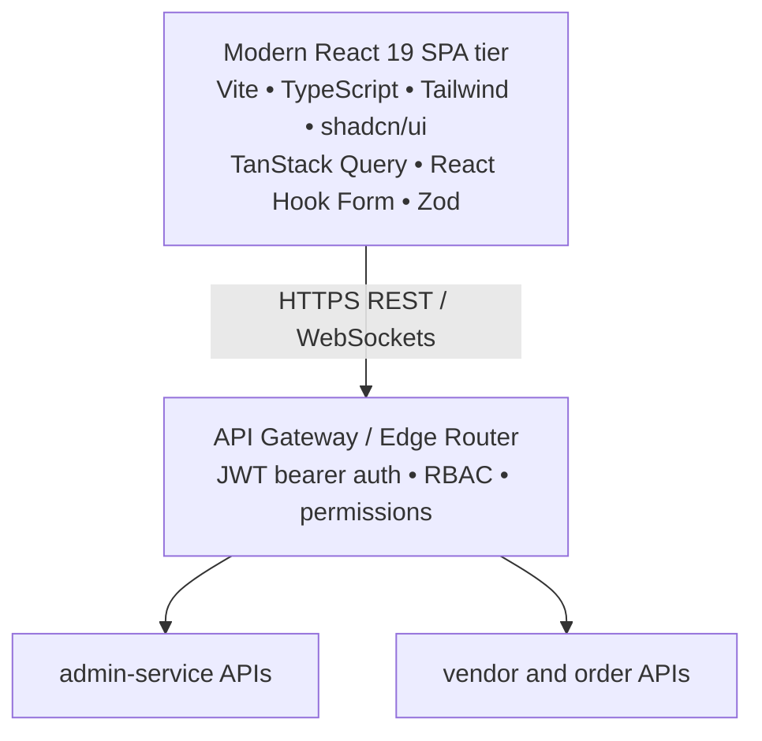

# Fattakse — Admin & Vendor Frontend Parity Matrix

**Document Version:** 2.0.0  
**Target Stack:** React 19 + TypeScript + Vite + Tailwind CSS + shadcn/ui  
**Backend Connectivity:** API Gateway -> Node.js Microservices  
**Legacy Baseline:** Laravel Blade Views (1,194 Admin Routes, 225 Vendor Routes)  
**Author:** Principal Frontend Architect & UX Lead  

---

## 1. Migration Architecture & Component Design

The legacy Blade server-rendered templates will be replaced by two modern, high-performance Single Page Applications (SPAs):
1. **`admin-react` (Fattakse Operations & Control Plane):** Central command center for management, financial reconciliation, master catalog, and fleet dispatch.
2. **`vendor-react` (Merchant & Dark Store Portal):** Clean, fast operational interface for Tirora dark-store pickers and local restaurant kitchens.



<details>
<summary>View the original text-only topology</summary>

```
+---------------------------------------------------------------------------------------+
|                                MODERN REACT 19 SPA TIER                               |
+---------------------------------------------------------------------------------------+
|  Vite 6 Bundler | TypeScript 5.6+ | Tailwind CSS | shadcn/ui Components | Lucide Icons|
|  TanStack Query v5 (Data Fetching & Cache) | React Hook Form + Zod (Strict Validation)|
+---------------------------------------------------------------------------------------+
                                           |
                                  HTTPS REST & WebSockets
                                           v
+---------------------------------------------------------------------------------------+
|                               API GATEWAY / EDGE ROUTER                               |
|              (JWT Bearer Auth, Strict RBAC Guards, Fine-Grained Permissions)          |
+---------------------------------------------------------------------------------------+
                                           |
              +----------------------------+----------------------------+
              |                                                         |
              v                                                         v
    +-----------------------------+                           +-----------------------------+
    |      admin-service APIs     |                           |    vendor / order APIs      |
    +-----------------------------+                           +-----------------------------+
```

</details>

---

## 2. Admin Control Plane (`admin-react`) Screen & Workflow Parity

| Legacy Blade Screen / Route | Proposed React Screen | Key Operational Workflows & Features | Target Milestone |
|---|---|---|---|
| `/admin/auth/login` | `/login` | Staff login, 2FA OTP verification, JWT session storage in memory + httpOnly cookie. | Month 2 (Week 5) |
| `/admin/item/*` | `/catalog/items` | Master catalog CRUD, variant builder, barcode search, nutrition badges, allergen tags. | Month 2 (Week 7) |
| `/admin/category/*` | `/catalog/categories` | Hierarchical category tree, department assignment, image banner uploads. | Month 2 (Week 7) |
| `/admin/store/*` | `/stores` | Merchant onboarding, zone boundary assignment, KYC document approvals, commission setup. | Month 2 (Week 6) |
| `/admin/order/list/*` | `/orders` | Real-time order dispatch board, SLA breach alerts, manual rider reassignment, cancel/refund modal. | Month 3 (Week 10) |
| `/admin/delivery-man/*`| `/fleet/riders` | Live Mapbox rider map, online toggle, cash-in-hand limit tracker, vehicle verification. | Month 3 (Week 11) |
| `/admin/account-transaction/*`| `/finance/ledger`| Unified financial ledger, Razorpay gateway fees, gross margin calculations. | Month 3 (Week 11) |
| `/admin/disbursement/*`| `/finance/payouts`| Automated merchant & rider payout runs, bank IFSC verification, TDS/TCS export. | Month 3 (Week 11) |
| `/admin/business-settings/*`| `/settings` | Delivery fee distance curves, platform fees, minimum order thresholds, maintenance mode. | Month 3 (Week 12) |
| `/admin/dashboard` | `/dashboard` | Live GMV, active orders count, pending approvals, rider online ratio, real-time metrics. | Month 3 (Week 12) |

---

## 3. Merchant & Dark Store Portal (`vendor-react`) Screen & Workflow Parity

| Persona | Legacy Blade Screen | Proposed React Screen | Key Operational Workflows & Features | Target Milestone |
|---|---|---|---|---|
| **Dark Store Picker** | Legacy POS / Till | `/picker/queue` | **Native Pick & Pack Queue:** Visual order cards sorted by delivery SLA. Barcode scanner support, item count verification, bag seal generation. | Month 3 (Week 10) |
| **Dark Store Manager**| `/vendor/item/*` | `/inventory/dark-store`| **Multi-Owner Stock Management:** Bin location assignments, inbound receiving scans, seller stock withdrawal approvals. | Month 3 (Week 9) |
| **Restaurant Kitchen** | `/vendor/order/*` | `/kitchen/live-orders` | **Kitchen Display Screen (KDS):** High-contrast order tickets, loud audio bell chime on new orders, prep countdown timer, "Ready for Pickup" button. | Month 3 (Week 10) |
| **Restaurant Manager** | `/vendor/item/status`| `/menu/availability` | Quick item 86-ing / out-of-stock toggle for kitchen rush hours, daily special pricing. | Month 3 (Week 10) |
| **Merchant Owner** | `/vendor/wallet/*` | `/finance/statements` | Daily/Weekly settlement statements, commission breakdowns, bank withdrawal requests. | Month 3 (Week 11) |

---

## 4. Modernized React User Web Storefront (`user-web`) — Full-Catalog Storefront with Integrated Paan Corner (18+)

**Strategic Role:** While the Flutter Mobile Suite is the primary app channel for regular on-the-go quick-commerce (kept **100% tobacco-free** for Google Play and Apple App Store compliance), the React User Web Storefront (`user-web` hosted at `fattakse.in` as a responsive mobile-first PWA) is maintained and modernized as a **full-catalog shopping surface**. 

Customers can order their complete basket — groceries, dark store essentials, restaurant meals, snacks, **and** paan corner / smoking products — in a single browsing session. This one-stop approach significantly boosts Average Order Value (AOV) and repeat retention, avoiding the drop-off of a restrictive tobacco-only app while remaining 100% immune from mobile app store policy rejections (since mobile browsers are exempt from app store developer policies).

| Screen / Route | Component Tech | Key Features & Regulatory Requirements | Target Milestone |
|---|---|---|---|
| `/` (Storefront Home) | React 19 + Tailwind CSS + Lucide | Unified hyperlocal discovery: Grocery, Food, Dark Store, and Paan Corner banners; location picker, search bar, active cart badge. | Month 2 (Week 8) |
| `/store/:id` & `/category/:id` | React 19 + TanStack Query | Dynamic store menu and category browsing with instant search, category filters, and product quantity steppers. | Month 2 (Week 8) |
| `/paan` & Tobacco Categories | React 19 + Framer Motion | **Mandatory 18+ Age Gate Interstitial:** Date-of-Birth declaration modal, statutory health warnings (*"Smoking Causes Cancer"*), COTPA 2003 affirmation before rendering smoking SKUs. | Month 2 (Week 8) |
| `/cart` & `/checkout` | React Hook Form + Zod | Hyperlocal dynamic delivery quote, multi-address selector, age verification reminder (if basket contains paan items), Razorpay UPI/Cards or Cash on Delivery (COD). | Month 3 (Week 10) |
| `/order/track/:id` | Socket.IO Client + Web Audio | Real-time order progress stepper and rider live tracking with doorstep delivery OTP and 18+ photo ID check alert banner (if order contains regulated items). | Month 3 (Week 11) |

---

## 5. Frontend Security & Authorization Standards

1. **Backend-Enforced Authorization:** Under no circumstances will frontend UI state (e.g. hiding a "Delete" button) be treated as security. Every API endpoint enforces strict RBAC guards (`@Roles('ADMIN', 'SUPER_ADMIN')` or `@Permissions('ORDER_REFUND')`).
2. **Zero Hardcoded API URLs:** Dynamic runtime configuration via environment variables (`VITE_API_BASE_URL`).
3. **App Store Protection via Header Firewalls:** The API Gateway inspects client signatures (`X-Software-Id`, `User-Agent`). Requests originating from mobile apps are strictly quarantined from tobacco items/stores. Only browser requests from `user-web` can access the full unrestricted catalog including paan corner SKUs.
4. **Optimistic UI with Automatic Rollback:** Stock toggles and order status advances use TanStack Query optimistic updates with automatic rollback and toast notifications on network or validation errors.

