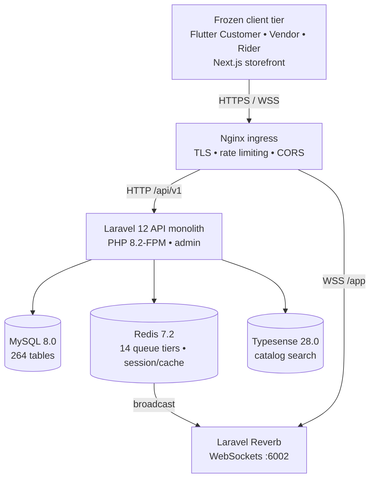

# Fattakse — Current System Architecture Audit

**Document Version:** 1.0.0  
**Audit Date:** October 2026  
**Status:** Approved for Modernization Discovery  
**Author:** Principal Software Architect & DevOps Lead  

---

## 1. Executive Summary & Production Topology

The Fattakse production platform is an Indian hyperlocal quick-commerce and multi-vendor delivery system serving small towns, with its flagship operating hub in **Tirora, Maharashtra (State Code 27)** under **Evolw Technologies Private Limited**.

The current production backend is a monolithic PHP 8.2 application running Laravel 12.x, deployed via Docker Compose on a single Hostinger VPS (`145.223.19.105`). The system interfaces with three Flutter mobile client applications (Customer, Vendor, Delivery Man), a Next.js web customer storefront, and legacy Blade-based administrative and vendor portals.

### 1.1 Reference Implementation Role During Parallel Greenfield Development
In the approved parallel development strategy:
- **Production Stays Untouched:** The Laravel application and its MySQL database (`fattakse_prod`) remain live and unmodified throughout Months 1–5.
- **Reference Implementation:** Laravel acts as the canonical reference specification for all business rules, tax calculations, and API contracts.
- **Zero Cross-Environment Contamination:** Development and staging clusters are completely isolated. No development code or experimental database mutations are permitted on this production system.



<details>
<summary>View the original text-only topology</summary>

```
                              +---------------------------------------+
                              |        Client Tier (FROZEN)           |
                              +---------------------------------------+
                              |  Flutter User App (v1.0.18 / #28)     |
                              |  Flutter Vendor App (v1.0.5 / #14)    |
                              |  Flutter Rider App (v1.0.1 / #14)     |
                              |  Next.js Storefront (web:3000)        |
                              +---------------------------------------+
                                                 |
                                     HTTPS / WSS (Port 443)
                                                 v
                              +---------------------------------------+
                              |             Nginx Ingress             |
                              | (SSL Termination, Rate Limiting, CORS)|
                              +---------------------------------------+
                                      |                       |
                     HTTP /api/v1/    |                       | WSS /app/*
                                      v                       v
                      +-----------------------------+  +-------------------+
                      |   Laravel 12 API Monolith   |  |  Laravel Reverb   |
                      |  PHP 8.2-FPM / Nginx (admin)|  | WebSockets :6002  |
                      +-----------------------------+  +-------------------+
                          |            |          |             ^
                          |            |          +-------------+ (Redis Broadcast)
                          v            v                  v
                 +--------------+ +---------------+ +--------------------+
                 |  MySQL 8.0   | |   Redis 7.2   | |   Typesense 28.0   |
                 |  Relational  | | 14 Queue Tiers| | Fast Fuzzy Search  |
                 | (264 Tables) | |  Session/Cache| | & Faceted Catalog  |
                 +--------------+ +---------------+ +--------------------+
```

</details>

---

## 2. Monolithic Application Inventory (`towns_fattakse_in/admin`)

### 2.1 Codebase Metrics
- **Framework:** Laravel 12.x on PHP 8.2.20
- **Total Relational Tables:** 264 tables (241 created in `database/migrations` + 23 in modular extensions).
- **Total Migrations:** 502 migration files.
- **Total Eloquent Models:** 256 models in `app/Models/`.
- **Total Route Definitions:** 1,935 routes across:
  - `routes/api/v1/api.php`: 431 routes (Mobile client and web storefront contract).
  - `routes/admin.php` & `routes/admin/routes.php`: 1,194 routes (Administrative control plane).
  - `routes/vendor.php`: 225 routes (Vendor portal workflows).
  - `routes/web.php`: 85 routes (Storefront views and auth redirects).
- **Background Scheduled Commands:** 32 scheduled cron jobs defined in `routes/schedule.php`.

### 2.2 Core Modules (`admin/Modules`)
1. **AI (`Modules/AI`):** Item description generation, smart catalog enrichment.
2. **TaxModule (`Modules/TaxModule`):** Indian GST breakdown (`order_taxes`, `system_tax_setups`, `taxables`, `hsn_gst_master`).
3. **Parcel (`Modules/Parcel`):** Point-to-point courier and parcel pickup/drop workflows (currently dormant/pilot phase).
4. **Rental (`Modules/Rental`):** Vehicle rental and fleet leasing workflows (dormant/pilot phase).

### 2.3 Authentication & Session Management
- **Customer Authentication:** Phone number + SMS OTP (`OtpController`, `OtpAuthController`), yielding a Laravel Passport OAuth2 Bearer token (`oauth_access_tokens`).
- **Vendor Authentication:** Email/Phone + Bcrypt password verification (`VendorAuthController`), yielding Passport Bearer tokens with vendor scope.
- **Delivery Man Authentication:** Phone number + Bcrypt password verification (`DeliveryManLoginController`), yielding Passport Bearer tokens with rider scope.
- **Admin Authentication:** Web session cookie with CSRF token for Blade dashboard access (`LoginController`), protected by `admin` middleware and custom role-based permissions (`admin_roles`, `admin_role_has_permissions`).

### 2.4 Real-time Communication & Asynchronous Workers
- **WebSocket Gateway:** Laravel Reverb running on internal port 6002, proxied via Nginx at `wss://ws.fattakse.in/app`.
- **Broadcasting Driver:** Redis Pub/Sub triggering Reverb channel broadcasts (`channels.php`).
- **Queue Subsystem:** Redis 7.2 cluster managing 14 distinct priority worker queues:
  1. `payments-critical`
  2. `orders-critical`
  3. `orders-high`
  4. `inventory-critical`
  5. `notifications-urgent`
  6. `notifications-high`
  7. `default`
  8. `pos-sync` (targeted for decommission)
  9. `search-indexing`
  10. `reports-heavy`
  11. `settlements`
  12. `webhooks`
  13. `audit-logging`
  14. `low`

---

## 3. Database Architecture & Hot Tables

MySQL 8.0 acts as the single source of truth. The schema exhibits high relational coupling, with several "hot tables" handling high read/write concurrency:

1. **`orders` (35+ columns):** Central order entity capturing customer, vendor, rider, financial breakdown (subtotal, tax, delivery fee, platform fee, tip, discount), lifecycle states, and delivery metadata.
2. **`order_details`:** Line items per order, linked to `items`, item variations, addon configurations, tax rates, and prices.
3. **`items` & `item_campaigns`:** Master catalog products, pricing, stock levels, unit definitions, category foreign keys, and module bindings.
4. **`stores` & `vendors`:** Merchant operational entities, delivery zones, tax configurations, opening hours, commission rules, and verification statuses.
5. **`delivery_men` & `delivery_man_wallets`:** Courier profiles, active shifts, online toggle, cash-in-hand limits, and pending payout balances.
6. **`order_transactions` & `account_transactions`:** Financial ledger capturing all revenue debits and credits, gateway fees, commissions, and rider earnings.
7. **`api_idempotency` & `cart_idempotencies`:** High-traffic deduplication tables ensuring order placement and payment webhooks do not execute twice.

---

## 4. External Integrations & 3rd Party Services

| Category | Service / Provider | Implementation Details |
|---|---|---|
| **Payment Gateway** | Razorpay | Standard Checkout, Payment Links, Webhooks (`payment/razorpay`), Order verification. |
| **Search Engine** | Typesense 28.0 | Real-time indexing of products, fuzzy typo tolerance, category faceting, multi-attribute filtering. |
| **Push Notifications** | Firebase Cloud Messaging (FCM) | Google Services OAuth2 HTTP v1 API targeting customer, vendor, and rider devices. |
| **SMS & OTP** | MSG91 / Fast2SMS / Twilio | Indian DLT-compliant SMS templates for customer phone verification. |
| **Maps & Geolocation** | Mapbox & Google Maps API | Reverse geocoding, distance matrix calculation, rider route tracking, polyline decoding. |
| **Observability** | Sentry (PHP & JS) | Real-time error capture and tracing for Laravel and Next.js storefront. |

---

## 5. Hyper POS Integration Context & Exclusion Rationale

### 5.1 Historical Hyper POS State
Previously, an external repository (`Hyper-POS-Fattakse`) provided an offline Windows/Electron retail till application designed for walk-in retail grocery stores. It synced with the monorepo via an HMAC-signed outbox/inbox bridge:
- **Routes:** 528 routes in `Hyper-POS-Fattakse` and 30+ sync endpoints in `admin/routes/api/v1/api.php` (`/pos/*`, `/erp/*`).
- **Jobs:** Scheduled synchronization daemons (`pos:bridge:relay-orders`, `pos:sync:reconcile-pending-deltas`, `erp:connector:sync`).
- **Dedicated Tables:** `pos_subscriptions`, `pos_sync_states`, `pos_security_states`, `pos_health_states`, `store_erp_connectors`, `pos_active_state_receipts`, `pos_inbound_quarantine`.

### 5.2 Executive Exclusion Directive
**Business Decision:** Evolw Technologies Private Limited operates **100% online hyperlocal commerce and dark-store fulfillment**. Offline walk-in counter retail is formally excluded.
**Modernization Impact:**
- All 7 POS-specific database tables are marked for immediate decommission.
- All 30+ POS outbox relay endpoints and HMAC bridge jobs are eliminated.
- Dark-store picking, packing, and stock management are returned to native, lightweight web/app workflows.

---

## 6. Current Operational & Production Baseline

- **Live Hostinger VPS:** `145.223.19.105`
- **Docker Compose Topology:**
  - `towns_fattakse_in_admin_1`: PHP 8.2-FPM + Nginx (Laravel backend)
  - `towns_fattakse_in_web_1`: Next.js 14 Web Storefront
  - `towns_fattakse_in_mysql_1`: MySQL 8.0.36
  - `towns_fattakse_in_redis_1`: Redis 7.2.4
  - `towns_fattakse_in_typesense_1`: Typesense 28.0
  - `towns_fattakse_in_reverb_1`: Reverb WebSocket server (:6002)
- **Live Health Endpoints:**
  - `https://fattakse.in/api/health` -> HTTP 200 OK
  - `https://admin.fattakse.in/api/health` -> HTTP 200 OK
  - `https://ws.fattakse.in/health` -> HTTP 200 OK
