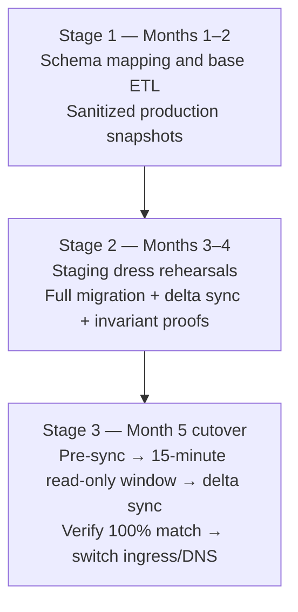

# Fattakse — Database Dependency & Ownership Matrix (Microservices)

**Document Version:** 2.0.0  
**Database Engine:** MySQL 8.0 (Retained with Logical Schema Isolation)  
**Total Tables Audited:** 264 Relational Tables  
**Architecture:** 8 Independent Domain Databases + 3-Stage ETL Migration  
**Author:** Principal Database Architect & Backend Lead  

---

## 1. Microservices Data Governance & Single-Writer Rule

In this parallel greenfield architecture:
1. **Dedicated Database per Microservice:** Data ownership is strictly partitioned into **8 isolated logical databases** on MySQL 8.0.
2. **Strict Single-Writer Invariant:** Exactly ONE microservice owns each logical database. No other service has write credentials to that database.
3. **No Cross-Service Database Joins:** Microservices cannot execute SQL `JOIN` statements across database boundaries. All inter-domain queries are conducted via internal APIs or asynchronous domain event projections.
4. **Decoupled Foreign Keys:** Physical relational foreign keys across different service boundaries are removed. Referential integrity across services is maintained at the application and event levels.

---

## 2. Logical Database Allocations & Table Ownership Matrix

```mermaid
flowchart TB
  IAM["iam-service<br/>fattakse_iam • 23 tables"]
  STORE["store-service<br/>fattakse_store • 16 tables"]
  CATALOG["catalog-service<br/>fattakse_catalog • 46 tables"]
  INVENTORY["inventory-service<br/>fattakse_inventory • 12 tables"]
  ORDER["order-service<br/>fattakse_order • 26 tables"]
  FLEET["fleet-service<br/>fattakse_fleet • 18 tables"]
  FINANCE["finance-service<br/>fattakse_finance • 28 tables"]
  NOTIFY["notify-service<br/>fattakse_notify • 15 tables"]
  RETIRED["Retired / archived<br/>7 POS tables • parcel/rental pilots • obsolete tables"]
  classDef active fill:#eff6ff,stroke:#2563eb,color:#172554
  classDef retired fill:#fef2f2,stroke:#dc2626,color:#7f1d1d
  class IAM,STORE,CATALOG,INVENTORY,ORDER,FLEET,FINANCE,NOTIFY active
  class RETIRED retired
```



<details>
<summary>View the original text-only partition matrix</summary>

```
+---------------------------------------------------------------------------------------------------+
|                                 LOGICAL DATABASE PARTITIONS                                       |
+---------------------------------------------------------------------------------------------------+
|  1. fattakse_iam (23 Tables)        2. fattakse_store (16 Tables)   3. fattakse_catalog (46 Tables)   |
|  - Owned by: iam-service            - Owned by: store-service       - Owned by: catalog-service   |
+---------------------------------------------------------------------------------------------------+
|  4. fattakse_inventory (12 Tables)  5. fattakse_order (26 Tables)   6. fattakse_fleet (18 Tables) |
|  - Owned by: inventory-service      - Owned by: order-service       - Owned by: fleet-service     |
+---------------------------------------------------------------------------------------------------+
|  7. fattakse_finance (28 Tables)    8. fattakse_notify (15 Tables)                                |
|  - Owned by: finance-service        - Owned by: notify-service                                    |
+---------------------------------------------------------------------------------------------------+
|  EXPLICITLY RETIRED (7 Tables): pos_subscriptions, pos_sync_states, store_erp_connectors, etc.      |
|  FROZEN PILOT ARCHIVE (9 Tables): parcel_*, rental_*                                              |
|  DROPPED / OBSOLETE (70+ Tables): legacy logs, redundant caches, obsolete Laravel session tables    |
+---------------------------------------------------------------------------------------------------+
```

</details>

### 2.1 Database 1: `fattakse_iam`
- **Owning Service:** `iam-service`
- **Tables (23):** `users`, `user_infos`, `guests`, `client_seen`, `admins`, `admin_roles`, `admin_role_has_permissions`, `admin_features`, `vendors`, `vendor_employees`, `delivery_men`, `oauth_access_tokens`, `oauth_auth_codes`, `oauth_clients`, `oauth_personal_access_clients`, `oauth_refresh_tokens`, `password_resets`, `phone_verifications`, `email_verifications`.
- **Integrity Rule:** Stores Passport RSA key pairs to validate existing mobile tokens without logging out users.

### 2.2 Database 2: `fattakse_store`
- **Owning Service:** `store-service`
- **Tables (16):** `stores`, `store_configs`, `store_types`, `store_subscriptions`, `store_onboarding_decisions`, `zones`, `module_activations`, `marketplace_module_targets`, `verticals`, `subscription_packages`, `vendor_wallets`.
- **Integrity Rule:** `zones.coordinates` holds MySQL Spatial polygons for boundary verification (`ST_Contains`).

### 2.3 Database 3: `fattakse_catalog`
- **Owning Service:** `catalog-service`
- **Tables (46):** `items`, `item_campaigns`, `master_products`, `master_variants`, `master_variant_values`, `categories`, `master_categories`, `category_departments`, `hierarchy_nodes`, `hierarchy_paths`, `brands`, `attributes`, `units`, `allergies`, `allergy_item`, `nutritions`, `barcode_lookup_cache`, `common_conditions`, `generic_names`, `hsn_gst_master`, `search_profiles`, `search_synonyms`.
- **Integrity Rule:** All mutations emit BullMQ events to maintain sub-second synchronization with Typesense 28.0.

### 2.4 Database 4: `fattakse_inventory`
- **Owning Service:** `inventory-service`
- **Tables (12):** `stocks`, `inventory_ledgers`, `seller_deposits`, `seller_deposit_items`, `stock_reservations`, `stock_withdrawals`, `stock_withdrawal_items`, `bin_locations`, `dark_store_racks`.
- **Integrity Rule:** High-concurrency ACID transactions; atomic reservation via `SELECT ... FOR UPDATE` pessimistically locks stock.

### 2.5 Database 5: `fattakse_order`
- **Owning Service:** `order-service`
- **Tables (26):** `orders`, `order_details`, `carts`, `cart_idempotencies`, `checkout_quotes`, `checkout_rule_sets`, `order_cancellation_reasons`, `refunds`, `refund_reasons`, `order_proofs`, `order_delivery_histories`, `api_idempotency`.
- **Integrity Rule:** Enforces the canonical order lifecycle state machine. Subsumes dark-store pick-and-pack queues.

### 2.6 Database 6: `fattakse_fleet`
- **Owning Service:** `fleet-service`
- **Tables (18):** `dm_vehicles`, `dm_vehicle_categories`, `dm_shifts`, `trips`, `trip_details`, `trip_transactions`, `delivery_man_wallets`, `delivery_histories`, `track_deliverymen`, `favorite_drivers`.
- **Integrity Rule:** Streams rider GPS telemetry; manages doorstep 18+ photo verification and 4-digit delivery OTPs.

### 2.7 Database 7: `fattakse_finance`
- **Owning Service:** `finance-service`
- **Tables (28):** `payments`, `partial_payments`, `order_transactions`, `account_transactions`, `admin_wallets`, `wallets`, `wallet_bonuses`, `wallet_transactions`, `disbursements`, `disbursement_details`, `disbursement_withdrawal_methods`, `cod_collections`, `cod_dispute_logs`, `cod_reconciliation_sessions`, `ledger_guard_state`.
- **Integrity Rule:** Immutable double-entry financial ledger; Razorpay cryptographic signature verification; automated daily COD cash reconciliation.

### 2.8 Database 8: `fattakse_notify`
- **Owning Service:** `notify-service`
- **Tables (15):** `notifications`, `automated_messages`, `conversations`, `contacts`, `fcm_tokens`, `outbox_events`, `webhook_events`, `webhook_dead_letter`.
- **Integrity Rule:** Manages asynchronous delivery of FCM push notifications and SMS DLT templates.

---

## 3. Explicitly Decommissioned Tables (Hyper POS & Obsolete)

The following tables are **permanently excluded** from the new platform:

| Table Name | Reason for Exclusion | Action |
|---|---|---|
| `pos_subscriptions` | Offline till licensing retired (100% online) | Purged |
| `pos_sync_states` | Offline-to-cloud delta sync retired | Purged |
| `pos_security_states` | POS hardware registration retired | Purged |
| `pos_health_states` | POS heartbeat telemetry retired | Purged |
| `store_erp_connectors` | Legacy physical ERP connector retired | Purged |
| `pos_active_state_receipts`| Offline counter receipt tracking retired | Purged |
| `pos_inbound_quarantine` | Corrupt offline till delta staging retired | Purged |
| `parcel_*` (2 tables) | Courier parcel module frozen pilot | Frozen in archive |
| `rental_*` (7 tables) | Rental vehicle module frozen pilot | Frozen in archive |

---

## 4. Five-Month Data Migration & Reconciliation Strategy

Because production operates continuously throughout the 5-month development period, we execute a **Three-Stage ETL Migration Strategy**:



<details>
<summary>View the original text-only ETL pipeline</summary>

```
+---------------------------------------------------------------------------------------------------+
|                                THREE-STAGE ETL DATA PIPELINE                                      |
+---------------------------------------------------------------------------------------------------+
|  STAGE 1: SCHEMA MAPPING & BASE ETL SCRIPT (Months 1–2)                                           |
|  - Write declarative Python/Node.js ETL scripts mapping 264 monolithic tables -> 8 domain schemas.|
|  - Test on local sanitized production snapshots. Anonymize PII for development.                  |
+---------------------------------------------------------------------------------------------------+
                                                  |
                                                  v
+---------------------------------------------------------------------------------------------------+
|  STAGE 2: STAGING DRESS REHEARSALS ON FRESH COPIES (Months 3–4)                                   |
|  - Rehearsal 1 (Month 3): Execute full ETL migration on a fresh copy of production; measure time.  |
|  - Rehearsal 2 (Month 4): Test incremental delta sync; run automated financial invariant proofs.   |
+---------------------------------------------------------------------------------------------------+
                                                  |
                                                  v
+---------------------------------------------------------------------------------------------------+
|  STAGE 3: CUTOVER NIGHT DELTA MIGRATION (Month 5 Maintenance Window, 02:00 AM IST)                |
|  1. Pre-sync historical data up to T_cutover minus 2 hours (while production is live).            |
|  2. Enter 15-minute maintenance mode (Laravel read-only).                                         |
|  3. Run Delta Sync capturing rows modified in final 2 hours (`updated_at >= T_sync`).             |
|  4. Run automated invariant verification script (100% match required).                             |
|  5. Switch Ingress / DNS to the new Microservices API Gateway.                                    |
+---------------------------------------------------------------------------------------------------+
```

</details>

### 4.1 Automated Financial & Data Invariant Proofs
Before cutover authorization, the automated reconciliation script verifies:
1. **User Identity Invariant:** Total active user count matches exactly; password hashes and phone numbers verified.
2. **Catalog Invariant:** Every active SKU retains its price, stock, unit, and barcode.
3. **Financial Ledger Invariant:** Every customer wallet balance, rider cash-in-hand balance, and merchant pending payout in `fattakse_finance` matches the legacy Laravel balance to the exact paisa (0.00 INR difference).
4. **Active Orders Invariant:** Any order in `processing`, `handover`, or `out_for_delivery` at the time of cutover retains its exact state and assigned rider.
