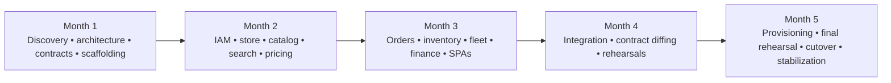

# Fattakse — Five-Month Execution Roadmap & Delivery Plan

**Execution Window:** November 2026 – March 2027 (Five Months / 20–22 Weeks)  
**Strategy:** Parallel Greenfield Microservices Build & Production Replacement  
**Status:** Approved Delivery Blueprint  
**Authors:** Principal Software Architect, Staff Backend Engineer, Migration Lead  

---

## 1. Scope Realism & Capacity Planning

### 1.1 Executive Delivery Assessment
- **Can 8 microservices, 2 React SPAs, and a production ETL pipeline be delivered in 5 months?**  
  **YES, subject to validated scope and dedicated staffing.** By building greenfield microservices in isolated environments, eliminating the overhead of live dual-writing or incremental Strangler Fig proxies, and permanently excluding Hyper POS, engineering velocity can focus 100% on domain implementation, Flutter contract parity, and data migration.
- **Scope Invariants:**
  - **IN SCOPE:** 8 Node.js/TypeScript microservices, API Gateway, React 19 Admin & Vendor SPAs, Typesense 28.0 integration, 3-stage ETL migration pipeline, frozen Flutter app contract parity, and cutover execution.
  - **EXPLICITLY OUT OF SCOPE:** Hyper POS & offline till sync (permanently excluded); Parcel and Rental verticals (frozen pilots in archive).

### 1.2 Dedicated Engineering Pod (8 FTEs)

| Role | Headcount | Primary Responsibilities |
|---|---|---|
| **Principal Architect & Project Lead** | 1 | Architecture governance, API contract validation, migration gates, cutover coordination. |
| **Senior Backend Microservice Engineers** | 3 | Core microservices (`iam`, `catalog`, `store`, `order`, `inventory`, `fleet`, `finance`), BullMQ jobs. |
| **Frontend Engineers (React 19 / TS)** | 2 | `admin-react` Operations Control Plane and `vendor-react` Dark Store Picker / Kitchen portals. |
| **Database & ETL Data Engineer** | 1 | Domain schemas, Prisma/Kysely migrations, 3-stage ETL migration scripts, reconciliation tests. |
| **SDET / QA Automation Engineer** | 1 | Automated API contract diffing, Flutter regression testing, k6 load testing. |
| **Total Engineering Pod** | **8 FTEs** | Dedicated full-time team. |

---

## 2. Five-Month Detailed Implementation Schedule



<details>
<summary>View the original text-only roadmap</summary>

```
+---------------------------------------------------------------------------------------------------+
|                               FIVE-MONTH DETAILED ROADMAP                                         |
+---------------------------------------------------------------------------------------------------+
|  MONTH 1 : Discovery, Architecture, Contract Freezing, Scaffolding, Dev Environments             |
|  MONTH 2 : Core Services Build (IAM, Store, Catalog, Typesense, Cart & Pricing)                   |
|  MONTH 3 : Core Services Build (Order, Native Dark-Store Pick/Pack, Fleet, Finance, React SPAs)   |
|  MONTH 4 : Integration Testing, Flutter Contract Diffing, Migration Rehearsals 1 & 2             |
|  MONTH 5 : Production Cluster Provisioning, Final Rehearsal, Scheduled Cutover, Stabilization     |
+---------------------------------------------------------------------------------------------------+
```

</details>

### Month 1: Discovery, Architecture, Toolchain & Scaffolding (Weeks 1–4)
- **Week 1: Architecture Sign-Off, Toolchain & Monorepo Scaffolding**
  - Finalize service boundaries, DTO schemas, and database ownership.
  - Setup **GitHub Projects** Kanban boards for weekly sprint tracking across the 8 FTE pod.
  - Scaffold pnpm monorepo with NestJS, Fastify, Kysely, and Prisma.
  - Configure **Gitleaks** pre-commit hooks and CI scans to block any secret leaks.
  - Setup **MkDocs Material** documentation site hosting architecture specs and runbooks.
- **Week 2: Isolated Development Environment & DevSecOps Baseline**
  - Configure Docker Compose local dev environments with isolated databases (`fattakse_dev_*`).
  - Configure Redis 7.2, Redpanda / Kafka event streaming broker, and Typesense 28.0 local containers.
  - Setup **Trivy** vulnerability scanning for Docker base images and npm dependencies.
  - Setup **Renovate** for automated dependency updates and security patches.
  - Configure **SonarQube Community Build** for automated code quality and maintainability scanning.
- **Week 3: API Contract Freezing, OpenAPI Specs & Bruno Collections**
  - Freeze Flutter API contracts; generate **OpenAPI 3.1** specifications for all 431 legacy routes.
  - Setup **Bruno** git-friendly API test collections (`.bru` files) covering all `/api/v1/*` contracts.
  - Setup CI pipelines in **GitHub Actions** (linting, type-checking, unit test runner, SonarQube quality gate).
- **Week 4: Data Migration Pipeline Stage 1 & Gate 1 Certification**
  - Build initial Stage 1 ETL migration scripts mapping monolithic tables to target domain schemas.
  - Test ETL extraction on sanitized local production database snapshots.
  - **Gate 1 Review:** Isolated dev environment running all 8 service skeletons; automated CI passing in GitHub Actions; Gitleaks clean; SonarQube Quality Gate passed.

### Month 2: Core Foundations & Catalog (Weeks 5–8)
- **Week 5: Identity & Access Service (`iam-service`)**
  - Implement customer mobile phone OTP flow (MSG91/Fast2SMS).
  - Implement vendor and rider email/phone + password authentication.
  - Load Laravel Passport RSA keypair (`oauth-public.key`) to emulate Passport JWT tokens.
- **Week 6: Store & Merchant Operations Service & Observability Baseline**
  - Implement merchant onboarding, KYC verification, and operating hours.
  - Implement spatial delivery zone boundary checks using MySQL spatial polygons (`ST_Contains`).
  - Wire **OpenTelemetry (OTel)** tracing across Fastify Gateway and microservices.
  - Setup **Prometheus** metrics scraping and **Grafana Loki** centralized logging for all containers.
- **Week 7: Catalog & Search Service (`catalog-service`)**
  - Implement master catalog items, categories, brands, variants, and barcodes.
  - Implement BullMQ change-data-capture worker for sub-second Typesense 28.0 indexing.
- **Week 8: Cart & Pricing Engine & Gate 2 Certification**
  - Implement cart synchronization in `order-service`.
  - Implement dynamic checkout quotations: Indian GST/HSN calculator, distance delivery matrix, platform fees.
  - Run **Bruno** API test collection for catalog & cart endpoints; verify **SonarQube** Quality Gate.
  - **Gate 2 Review:** Flutter Customer app authenticates, searches Typesense catalog, and builds a cart against Staging.

### Month 3: Transactions, Fulfillment & Frontends (Weeks 9–12)
- **Week 9: Inventory Service (`inventory-service`)**
  - Implement atomic stock reservation via MySQL `SELECT ... FOR UPDATE` pessimistic locks.
  - Implement Tirora dark-store multi-owner inventory ledger (Evolw-owned vs. Seller-deposited).
  - Implement urgent seller stock return/withdrawal workflow.
- **Week 10: Order Engine, Kafka Event Streaming & Dark Store Fulfillment**
  - Implement `order-service` state machine (`pending` -> `confirmed` -> `processing` -> `handover` -> `delivered`).
  - Wire Transactional Outbox to publish order state transitions to Kafka `fattakse.orders.lifecycle` topic.
  - Subsume POS: Build native dark-store Pick-and-Pack queue and barcode verification in React Vendor portal.
- **Week 11: Fleet & Delivery (`fleet-service`) + Finance (`finance-service`)**
  - Implement proximity dispatch, Kafka `fattakse.riders.telemetry` GPS streaming, WebSocket tracking, and delivery OTP verification.
  - Wire `finance-service` Kafka consumer to generate double-entry ledger entries upon `order.delivered` events.
  - Implement Razorpay webhook verification and Cash on Delivery (COD) rider cash-in-hand ledgers.
- **Week 12: Portals Complete & Playwright E2E Automation**
  - Deliver `admin-react` Operations Control Plane (live dispatch board, catalog CRUD, payouts).
  - Deliver `vendor-react` Kitchen Display Screen (KDS) and dark-store picker display.
  - Deliver `user-web` Full-Catalog Consumer Web Storefront (React 19 PWA at `fattakse.in` with integrated 18+ Paan Corner).
  - Implement **Playwright** automated browser test suites testing all 3 portals end-to-end.
  - **Gate 3 Review:** End-to-end order placed on mobile and web, picked via React portal, dispatched to rider, and delivered with OTP in Staging. Playwright tests pass 100%.

### Month 4: Integration, Acceptance & Migration Rehearsals (Weeks 13–16)
- **Week 13: Bruno Contract Testing & Flutter Regression**
  - Execute automated **Bruno** test collections running contract diffing across all 431 legacy routes.
  - Run headless Flutter integration test suites across Customer, Vendor, and Rider apps.
- **Week 14: Migration Rehearsal 1 (Full Production Copy)**
  - Execute full Stage 2 ETL migration on a fresh production backup copy.
  - Measure total extraction and loading time; verify zero data corruption.
- **Week 15: Concurrency, Load (k6), Kafka Streaming & Security Testing**
  - Execute **k6** load tests targeting 1,500 req/sec (p95 < 180ms) with zero Kafka consumer lag.
  - Verify zero stock overselling under 100 concurrent checkout race conditions via k6.
  - Execute Kafka consumer offset replay test: verify idempotent ledger reconstruction with 0.00 INR balance drift.
  - Execute **Trivy** container image vulnerability scans and **Gitleaks** repository audit.
- **Week 16: Migration Rehearsal 2 (Delta Synchronization & Financial Proofs)**
  - Rehearse incremental delta backfill.
  - Run automated financial ledger reconciliation: verify wallet balances and payout ledgers match to the exact paisa (0.00 INR variance).
  - **Gate 4 Review:** 100% Bruno contract tests passing; Playwright tests green; SonarQube Quality Gate passed; zero financial discrepancies.

### Month 5: Final Validation, Cutover & Stabilization (Weeks 17–20)
- **Week 17: Production Cluster Provisioning & Observability Setup**
  - Provision target production infrastructure (Docker Compose, MySQL 8.0, Redis 7.2, Redpanda / Kafka, Typesense 28.0).
  - Deploy **Prometheus + Grafana** production dashboards and **Grafana Loki** log shipping.
  - Pre-sync historical production data up to T_cutover minus 2 hours.
- **Week 18: Dress Rehearsal 3 (Full Simulation)**
  - Execute final dry run under simulated maintenance window conditions with all engineering stakeholders.
- **Week 19: PRODUCTION CUTOVER NIGHT (Scheduled 15-Minute Window, 02:00 AM IST)**
  - 02:00 AM: Announce scheduled maintenance; put Laravel monolith into read-only mode.
  - 02:05 AM: Execute Delta ETL migration script (capturing final 2 hours of transactions).
  - 02:10 AM: Run automated invariant reconciliation script (100% record and balance match).
  - 02:12 AM: Switch Nginx Ingress / DNS to the new Microservices API Gateway.
  - 02:14 AM: Validate production health checks (`/api/health`); release mobile app traffic.
- **Week 20: Post-Launch Hypercare & Stabilization**
  - 24x7 engineering on-call monitoring of Sentry error rates, database locks, and payment webhooks.
  - Formal project sign-off; archive legacy Laravel codebase.

---

## 3. Go/No-Go Acceptance Gates

| Phase Gate | Mandatory Go/No-Go Acceptance Criteria | Failure Action / Fallback |
|---|---|---|
| **GATE 1 (End of Month 1)** | Service boundaries finalized; isolated dev environments operational; Flutter contracts frozen. | Halt development until architecture and contracts are signed off. |
| **GATE 2 (End of Month 2)** | IAM, Catalog, and Typesense pass automated mobile contract tests in Staging. | Refactor failing endpoints before proceeding to order transactions. |
| **GATE 3 (End of Month 3)** | End-to-end order placement, pick/pack, dispatch, Razorpay payment, and React panels verified. | Resolve transactional bugs; do not proceed to rehearsals with known race conditions. |
| **GATE 4 (End of Month 4)** | Contract diffing suite 100% green; ETL rehearsal verifies zero financial variance; k6 load test passes at 1,500 req/sec. | **No-Go for Cutover:** Postpone production maintenance window until reconciliation is 100% clean. |
| **GATE 5 (Cutover Night)** | Delta ETL sync completes in < 15 minutes; automated ledger checksums match 100%; health checks HTTP 200 OK. | **Trigger 60-Second Rollback:** Switch Nginx pointer back to Laravel; restore Laravel read/write mode; zero data loss. |
