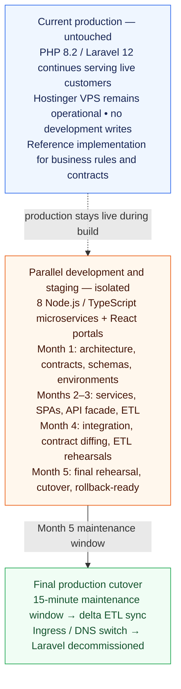
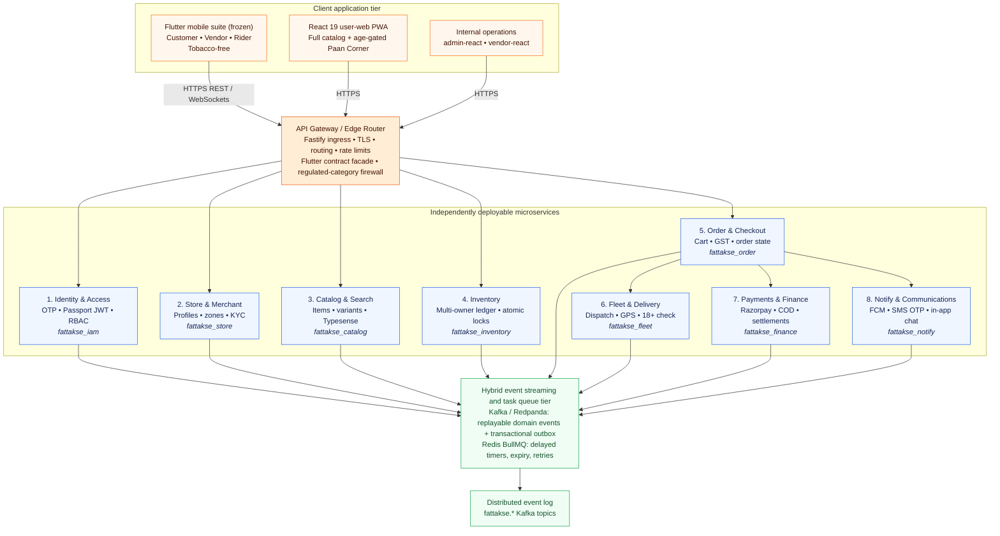

# Fattakse — Target System Architecture Design (Parallel Greenfield Microservices)

**Document Version:** 2.0.0  
**Target Delivery Window:** Five Months (20–22 Weeks)  
**Strategy:** Parallel Greenfield Microservices Development & Production Replacement  
**Status:** Approved Target Architecture  
**Authors:** Principal Software Architect, Staff Backend Engineer, Database Architect, DevOps Lead  

---

## 1. Architectural Strategy & Paradigm Decision

### 1.1 The Strategic Shift: Parallel Greenfield Microservices vs. Incremental Monolith Migration

We have explicitly rejected the incremental Strangler Fig migration and the modular monolith topology in favor of a **Parallel Greenfield Microservices Architecture**:



<details>
<summary>View the original text-only topology</summary>

```
+---------------------------------------------------------------------------------------------------+
|                                  PARALLEL GREENFIELD TOPOLOGY                                     |
+---------------------------------------------------------------------------------------------------+
|  CURRENT PRODUCTION (UNTOUCHED)                                                                  |
|  PHP 8.2 / Laravel 12 Monolith continues serving live Flutter apps & customers without disruption. |
|  - Hostinger VPS (145.223.19.105) remains operational throughout Months 1–5.                       |
|  - Zero incremental traffic routing during development. Zero development writes to production DB.  |
|  - Acts as the Reference Implementation for business logic, validation rules, and contracts.      |
+---------------------------------------------------------------------------------------------------+
|                                                                                                   |
|  PARALLEL DEVELOPMENT & STAGING CLUSTER (ISOLATED)                                                |
|  Build 8 independent Node.js/TypeScript microservices + React Admin/Vendor panels.               |
|  - Month 1: Architecture, contracts, domain schemas, dev environments.                            |
|  - Months 2–3: Core microservices build, React SPAs, Flutter API facade, ETL migration scripts.    |
|  - Month 4: Integration testing, Flutter contract diffing, ETL rehearsals on production copies.  |
|  - Month 5: Final rehearsal, scheduled cutover maintenance window, verification, rollback-ready.  |
+---------------------------------------------------------------------------------------------------+
                                                  |
                                                  v  (Month 5 Maintenance Window)
+---------------------------------------------------------------------------------------------------+
|                                    FINAL PRODUCTION CUTOVER                                       |
|  15-minute maintenance window -> Delta ETL sync -> Ingress/DNS switch -> Laravel decommissioned   |
+---------------------------------------------------------------------------------------------------+
```

</details>

### 1.2 Core Architectural Principles
1. **Isolated Environments:** Development and staging clusters are completely decoupled from production. Developers never connect to or modify production databases.
2. **True Service Independence:** Each microservice is an independently deployable Node.js application owning its private logical database schema. Cross-service database joins are architecturally forbidden.
3. **Reference Implementation Parity:** The live Laravel monolith is treated as the executable specification. Every feature, tax calculation, and validation rule must achieve verified parity with Laravel.
4. **Complete Exclusion of Hyper POS:** Offline counter POS, walk-in till sync, scale barcode parsers, and receipt printing are retired. Fulfillment is 100% digital quick-commerce (Tirora dark store) and restaurant food delivery.
5. **Frozen Mobile Clients:** Flutter Customer (`1.0.18`), Vendor (`1.0.5`), and Rider (`1.0.1`) apps remain architecturally frozen. The new API Gateway emulates all legacy Laravel endpoints byte-for-byte.

---

## 2. Target Microservices Topology & Boundaries

The target backend consists of **8 independently deployable microservices** fronted by a high-performance **API Gateway / Edge Router**:



<details>
<summary>View the original text-only topology</summary>

```
                                  +--------------------------------------------------------------+
                                  |                      CLIENT APPLICATION TIER                 |
                                  |                                                              |
                                  |  [PRIMARY: FLUTTER MOBILE SUITE (FROZEN / UNCHANGED)]        |
                                  |  - Flutter Customer App (v1.0.18): Grocery, Dark Store, Food |
                                  |    100% TOBACCO-FREE (Google Play & Apple App Store safe)     |
                                  |  - Flutter Vendor App (v1.0.5): Merchant Store Operations    |
                                  |  - Flutter Rider App (v1.0.1): Live Dispatch, 18+ ID, OTP    |
                                  |                                                              |
                                  |  [FULL-CATALOG USER WEB STOREFRONT (user-web)]               |
                                  |  - React 19 PWA at fattakse.in (Mobile-First Responsive)     |
                                  |    Sells EVERYTHING: Grocery + Dark Store + Food + Paan      |
                                  |    Corner (Tobacco/Smoking) — UNRESTRICTED by App Stores     |
                                  |  - Tobacco category pages enforce COTPA 2003 age-gating,     |
                                  |    statutory health warnings, & 100m school geofence          |
                                  |  - One-stop shop drives higher AOV vs tobacco-only web app   |
                                  |                                                              |
                                  |  [INTERNAL OPERATIONS CONTROL PLANES]                        |
                                  |  - React 19 Admin Control Plane (admin-react)                |
                                  |  - React 19 Dark Store Picker & KDS Portal (vendor-react)    |
                                  +--------------------------------------------------------------+
                                                                 |
                                                        HTTPS REST / WebSockets
                                                                 v
                                  +--------------------------------------------------------------+
                                  |                 API GATEWAY / EDGE ROUTER                    |
                                  | (Fastify / Reverse Proxy Ingress)                            |
                                  | - Request routing & SSL termination                          |
                                  | - Flutter contract formatting facade                         |
                                  | - Rate limiting, zone normalization                          |
                                  | - Regulated category firewall (blocks tobacco on mobile      |
                                  |   apps only; web storefront receives full catalog)            |
                                  +--------------------------------------------------------------+
                                                     |
            +--------------------+-------------------+--------------------+--------------------+
            |                    |                   |                    |                    |
            v                    v                   v                    v                    v
    +---------------+    +---------------+   +---------------+    +---------------+    +---------------+
    | 1. IDENTITY   |    | 2. STORE &    |   | 3. CATALOG    |    | 4. INVENTORY  |    | 5. ORDER &    |
    |    & ACCESS   |    |    MERCHANT   |   |    & SEARCH   |    |    SERVICE    |    |    CHECKOUT   |
    | - OTP auth    |    | - Profiles    |   | - Master items|    | - Multi-owner |    | - Cart rules  |
    | - Passport JWT|    | - Zones (GIS) |   | - Variants    |    |   ledger      |    | - Quotes & GST|
    | - RBAC roles  |    | - KYC verify  |   | - Typesense   |    | - Atomic lock |    | - Order state |
    +---------------+    +---------------+   +---------------+    +---------------+    +---------------+
            |                    |                   |                    |                    |
            | (fattakse_iam)     | (fattakse_store)  | (fattakse_catalog) | (fattakse_inventory| (fattakse_order)
            |                    |                   |                    |                    |
            +--------------------+-------------------+--------------------+--------------------+
                                 |                                        |
                                 v                                        v
                         +---------------+                        +---------------+
                         | 6. FLEET &    |                        | 7. PAYMENTS & |
                         |    DELIVERY   |                        |    FINANCE    |
                         | - Proximity   |                        | - Razorpay    |
                         | - GPS streams |                        | - COD ledger  |
                         | - Doorstep 18+|                        | - Settlements |
                         +---------------+                        +---------------+
                                 |                                        |
                                 | (fattakse_fleet)                       | (fattakse_finance)
                                 |                                        |
                                 +--------------------+-------------------+
                                                      |
                                                      v
                                              +---------------+
                                              | 8. NOTIFY &   |
                                              |    COMMUNS    |
                                              | - FCM push    |
                                              | - SMS DLT OTP |
                                              | - In-app chat |
                                              +---------------+
                                                      | (fattakse_notify)
                                                      |
                                                      | (fattakse_notify)
                                                      |
                  Hybrid Event Streaming & Task Queue Tier:
                  - Kafka / Redpanda: High-throughput replayable event log (Order lifecycle, Rider GPS, Ledger)
                  - Redis BullMQ: Delayed timers (Kitchen 3m SLA, OTP expiry, retries)
                                                      v
                                         +--------------------------+
                                         |  Distributed Event Log   |
                                         | (fattakse.* Kafka topics |
                                         |  & Transactional Outbox) |
                                         +--------------------------+
```

</details>

---

## 3. Justified Service Responsibilities & Domain Scopes

Each microservice represents a bounded business domain with clear data ownership and independent scaling characteristics:

### 3.1 Service Definitions

1. **Identity & Access Service (`iam-service`):**
   - **Scope:** Customer mobile OTP verification, vendor/rider email/phone + password authentication, Passport RSA JWT verification, RBAC permissions.
   - **Data Ownership:** `fattakse_iam` (`users`, `user_infos`, `admins`, `admin_roles`, `oauth_access_tokens`).
   - **Rationale for Independence:** Security boundary; prevents token issuance failure from affecting catalog browsing.

2. **Store & Merchant Operations Service (`store-service`):**
   - **Scope:** Merchant profiles, document verification, store operational hours, spatial delivery zone boundaries (`ST_Contains` polygon checks), store commissions.
   - **Data Ownership:** `fattakse_store` (`stores`, `store_configs`, `zones`, `subscription_packages`).
   - **Rationale for Independence:** Infrequently changed master data; heavily cached across edge nodes.

3. **Catalog & Search Service (`catalog-service`):**
   - **Scope:** Master catalog items, categories, brands, variants, barcodes, nutrition badges, allergen tags, real-time Typesense 28.0 indexing.
   - **Data Ownership:** `fattakse_catalog` (`items`, `master_products`, `categories`, `brands`, `attributes`, `units`, `hsn_gst_master`).
   - **Rationale for Independence:** Accounts for 85%+ of read traffic; must scale horizontally with read replicas without burdening order processing.

4. **Inventory Service (`inventory-service`):**
   - **Scope:** Real-time stock levels, atomic stock reservation at checkout, Tirora dark-store multi-owner inventory (Evolw-owned vs. Seller-deposited), bin locations, seller urgent stock returns.
   - **Data Ownership:** `fattakse_inventory` (`stocks`, `inventory_ledgers`, `seller_deposits`, `stock_withdrawals`).
   - **Rationale for Independence:** High-concurrency ACID transactional boundary; enforces atomic inventory reservation without locking order or catalog tables.

5. **Order & Checkout Service (`order-service`):**
   - **Scope:** Customer carts, checkout quotes (distance delivery fee, Indian GST/HSN, platform fees, tips, coupons), order lifecycle state machine, dark-store pick-and-pack queue, restaurant kitchen display tickets.
   - **Data Ownership:** `fattakse_order` (`orders`, `order_details`, `carts`, `checkout_quotes`, `order_cancellation_reasons`, `refunds`).
   - **Rationale for Independence:** Core commerce transaction engine; manages state transitions (`pending` -> `confirmed` -> `processing` -> `handover` -> `delivered`).

6. **Fleet & Delivery Service (`fleet-service`):**
   - **Scope:** Rider profiles, shift management, proximity dispatch algorithm, live GPS coordinate ingestion via WebSockets, doorstep 18+ ID check, delivery OTP verification.
   - **Data Ownership:** `fattakse_fleet` (`delivery_men`, `dm_vehicles`, `dm_shifts`, `trips`, `trip_details`, `track_deliverymen`).
   - **Rationale for Independence:** Real-time telemetry and WebSocket streaming; high network I/O that must be isolated from transactional checkout.

7. **Payment & Financial Settlement Service (`finance-service`):**
   - **Scope:** Razorpay webhook capture, signature verification, Cash on Delivery (COD) collection, rider cash-in-hand limits, merchant weekly payouts, GST TCS/TDS reporting.
   - **Data Ownership:** `fattakse_finance` (`payments`, `order_transactions`, `account_transactions`, `wallets`, `disbursements`, `cod_collections`).
   - **Rationale for Independence:** Immutable audit ledger; financial compliance requirements demand strict data isolation and restricted access.

8. **Notification & Communications Service (`notify-service`):**
   - **Scope:** Firebase Cloud Messaging (FCM HTTP v1), Indian DLT-compliant SMS OTP dispatch (MSG91), customer support messaging.
   - **Data Ownership:** `fattakse_notify` (`notifications`, `conversations`, `automated_messages`, `fcm_tokens`).
   - **Rationale for Independence:** Isolates third-party external network latencies from synchronous API request lifecycles.

---

## 4. Inter-Service Communication & Data Consistency

### 4.1 Synchronous Communication (HTTP/REST & gRPC)
- Used strictly for point-to-point queries where real-time consistency is mandatory (e.g. `order-service` calls `inventory-service.reserveStock()` during checkout).
- All inter-service calls use strict timeouts (500ms max) and circuit breakers.

### 4.2 Hybrid Asynchronous Event Streaming & Task Queues (Kafka / Redpanda + Redis BullMQ)

Fattakse uses a complementary **hybrid asynchronous architecture**:

1. **Kafka / Redpanda Distributed Event Log (Domain Events & Telemetry):**
   - High-throughput, distributed, append-only commit log with consumer groups (`kafkajs` / `@nestjs/microservices`).
   - **Key Kafka Topics & Partition Keys:**
     - `fattakse.orders.lifecycle` (Key: `order_id`): Guarantees strict sequential ordering of state transitions (`ORDER_CREATED` -> `CONFIRMED` -> `PICKED` -> `DISPATCHED` -> `DELIVERED`). Multi-consumer fan-out allows `fleet-service`, `finance-service`, `inventory-service`, and `notify-service` to consume concurrently without blocking each other.
     - `fattakse.riders.telemetry` (Key: `rider_id`): High-frequency GPS coordinates streamed every 2–3s from delivery riders without hammering MySQL disk I/O.
     - `fattakse.inventory.adjustments` (Key: `item_id`): Dark store bin inventory deductions and out-of-stock events broadcast to catalog and Typesense search.
     - `fattakse.finance.transactions` (Key: `transaction_id`): Double-entry ledger events, Razorpay webhook events, and merchant payout journal entries.
   - **Audit Replayability:** Consumer offsets can be reset to replay historical transactions for financial audits, debugging, and invariant verification.
   - **Engine Choice:** **Redpanda** (C++, 100% Kafka API compatible, zero JVM, zero ZooKeeper, single static binary using < 500MB RAM) or Apache Kafka 3.8+ (KRaft mode).

2. **Redis BullMQ Task Queue Engine (Delayed Timers & Scheduled Jobs):**
   - Point-to-point worker queues for delayed jobs and retry loops:
     - 3-minute restaurant SLA auto-cancellation timers.
     - 10-minute customer phone OTP expiration.
     - Exponential backoff retries for external third-party HTTP webhooks.

3. **Transactional Outbox Pattern & Idempotency:**
   - Every microservice writes domain events to a local `outbox_events` table within the same MySQL transaction that modifies business data, guaranteeing zero lost events.
   - An outbox relay publishes to Kafka/Redpanda. Consumers verify event UUIDs against an `idempotency_keys` table to handle at-least-once delivery safely.

---

## 5. Technology Stack Selection

- **Backend Runtime:** Node.js 22 LTS with TypeScript 5.6+.
- **Service Framework:** NestJS 11+ with Fastify HTTP engine (`@nestjs/platform-fastify`).
- **Primary Relational Databases:** **MySQL 8.4 LTS** with single-writer isolated schemas (`fattakse_iam`, `fattakse_catalog`, etc.).
- **Query & Data Access Layer:** Kysely (type-safe SQL for high-concurrency transactional queries and GIS operations) + Prisma ORM (schema definitions and declarative migrations).
- **Containerization & Ingress:** **Docker** (multi-stage builds, rootless container security) and **Nginx** (reverse proxy, TLS 1.3 termination, gzip/brotli compression, rate limiting, and 60-second cutover switching).
- **Event Streaming Backbone:** Redpanda / Apache Kafka (Kafka API v3.x+, C++ engine with sub-millisecond latency and low RAM footprint).
- **Asynchronous Task Queues & Caching:** **Redis 7.2 with BullMQ** (distributed caching, session store, 3-minute kitchen SLA timers, 10-minute OTP expiration).
- **Search Engine:** **Typesense 28.0** (sub-50ms typo-tolerant catalog search, CDC streaming).
- **WebSockets:** Socket.IO / `@nestjs/websockets` (emulating Laravel Reverb / Pusher wire protocols).
- **Frontend SPAs & Web Storefront:** React 19 + TypeScript + Vite + Tailwind CSS + shadcn/ui (`admin-react` Operations Control Plane, `vendor-react` Dark Store Picker / KDS, and `user-web` Full-Catalog Mobile-First Consumer Web Storefront with integrated Paan Corner).

---

## 6. Engineering Toolchain, DevSecOps & Observability Platform

The greenfield modernization pod enforces a unified, open-source-first engineering toolchain to ensure code quality, automated testing, security, disaster recovery, and real-time operational visibility:

| Category | Tool | Implementation & Purpose in Fattakse Modernization |
|---|---|---|
| **Code Management & CI/CD** | **GitHub + GitHub Actions** | Monorepo source control, branch protection rules (`main`), automated linting, type-checking, Docker image builds, and multi-stage deployment workflows. |
| **Project & Sprint Tracking** | **GitHub Projects** | Visual Kanban boards, sprint backlogs, and week-by-week task management mapped to the 8 FTE pod across Weeks 1–20. |
| **Code Quality & Static Analysis** | **SonarQube Community Build** | Automated code quality analysis, maintainability metrics, code smell detection, and strict Quality Gate enforcement (> 80% coverage, 0 security vulnerabilities). |
| **Secrets & Credential Security** | **Gitleaks** | Pre-commit hooks (`.pre-commit-config.yaml`) and GitHub Actions scanning to prevent any hardcoded API keys, JWT secrets, or DB passwords from ever being committed. |
| **Vulnerability Scanning** | **Trivy** | Container image and npm/pnpm dependency vulnerability scanning in CI. Rejects any build containing unpatched CRITICAL or HIGH CVEs. |
| **DAST Security Penetration Testing** | **OWASP ZAP (Zed Attack Proxy)**| Automated Dynamic Application Security Testing (DAST) scans in CI/staging targeting Fastify API Gateway, web storefront, and admin portals for OWASP Top 10 vulnerabilities. |
| **Isolated Container Testing** | **Testcontainers** | Spins up real, disposable Docker containers (MySQL 8.4, Redis 7.2, Redpanda) inside Vitest integration tests, guaranteeing tests run against authentic database engines. |
| **End-to-End Browser Testing** | **Playwright** | Headless browser automation for `admin-react` operations, `vendor-react` digital Pick & Pack queues, and `user-web` full-catalog checkout & 18+ age gate flows. |
| **Automated API Testing** | **Bruno** | Git-friendly, plain-text API testing collections (`.bru` files) stored directly in the repository to continuously test and regression-proof all 431 `/api/v1/*` contracts. |
| **API Contracts & Documentation** | **OpenAPI (Swagger / ReDoc)** | Auto-generated OpenAPI 3.1 specifications from NestJS Fastify decorators, providing canonical schemas for backend services and mobile client verification. |
| **Metrics, Dashboards & Alerts** | **Prometheus + Grafana** | Prometheus scrapes container metrics (`/metrics`), Node.js event-loop lag, and Kafka topic lag; Grafana renders operational dashboards and fires Slack/PagerDuty alerts. |
| **Centralized Log Aggregation** | **Grafana Loki** | Lightweight log aggregation receiving structured Pino JSON logs from all microservice containers via Promtail/Docker log drivers. |
| **Distributed Tracing** | **OpenTelemetry (OTel)** | Distributed tracing across API Gateway, microservices, Redpanda/Kafka events, and database queries with correlation IDs (`x-correlation-id`). |
| **Application Error Monitoring** | **Sentry** | Real-time full-stack exception and crash monitoring for Node.js microservices, React SPAs, and Flutter clients, tracking release health and stack traces. |
| **Uptime & Heartbeat Monitoring** | **Uptime Kuma** | Self-hosted uptime monitor polling public endpoints (`/health`), WebSockets, and external dependencies every 30s with a public status page at `status.fattakse.in`. |
| **Disaster Recovery & Backup** | **Restic + Off-site Storage** | Secure, encrypted, deduplicated automated snapshots of MySQL volumes and Redpanda data shipped to Wasabi / S3 Glacier with hourly and daily retention. |
| **Performance & Load Testing** | **k6** | Scriptable load testing verifying the 1,500 req/s baseline, checkout concurrency race conditions, and p95 latency (< 180ms). |
| **Automated Dependency Updates**| **Renovate** | Automated PRs for keeping npm dependencies, Docker base images, and GitHub Actions up-to-date with security patches. |
| **Engineering Documentation** | **MkDocs Material** | Fast, searchable documentation portal hosting architectural specs, ADRs, runbooks, and API guides directly from markdown. |


